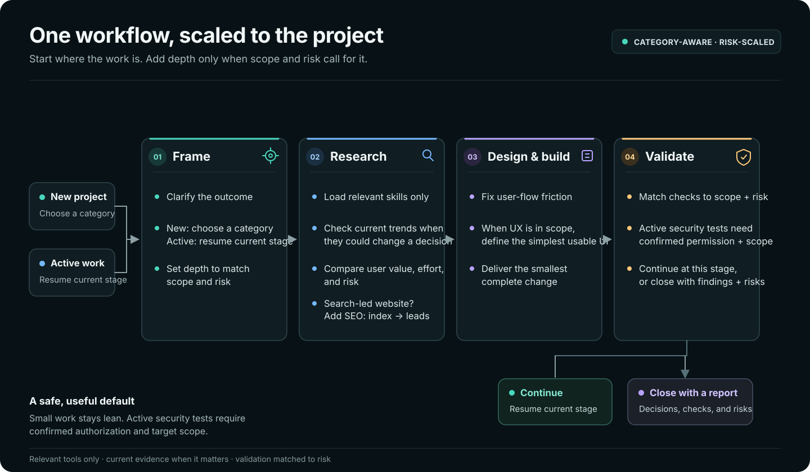

# Project Flow

A category-aware project skill for Codex, Claude Code, Qwen Code, and other agents that support the shared Agent Skills format.

Project Flow helps an agent understand a new or active project, select a useful depth, research current category trends, compare feature choices, improve UX and UI where relevant, and research, map, and implement SEO improvements for public websites when organic search can drive growth. It plans proportionate quality and security checks and routes optional local skills only when they fit the task.

## Install

Requires Node.js 22.20+. At the prompts, select `project-flow` and the agents you want to install it for.

```sh
npx skills add sahibsingh/project-flow -g
```

## Start a project

Invoke `project-flow` or describe the project. The skill summarizes its understanding, asks for a primary category when one has not been chosen, then follows the current project stage. Categories are Product/Software, UX/UI, Business/Market, Data/Analytics, Content/Marketing, Research/Docs, Operations/Automation, Creative/Media, and Other. A secondary category can be added for work that crosses areas.

The skill has three depth lanes: Quick for one low-risk outcome, Standard for several flows or integrations, and High assurance for sensitive, regulated, production, or security-sensitive work. It keeps small tasks short and does not load every reference or integration at once.

## Workflow



When design work can benefit from Mobbin, follow this route: read Mobbin's best-practices guidance first; go straight to a redesign for one named screen, flow, section, or component; search or compare first only when references are a separate requested step, then carry inspected apps and Mobbin links into the redesign. Split whole-product or clone requests into specific targets. If an explicitly requested Mobbin step is unavailable, report the actual connection or tool error and stop that step instead of substituting web search or memory. General UX work can continue with project evidence and a clearly labeled manual review.

## Try the demo

A no-build interactive preview is in [docs/index.html](docs/index.html). It lets a visitor choose a project category and depth, then shows the matching work path.

To publish it with GitHub Pages, open **Settings → Pages**, select **Deploy from a branch**, then choose branch <code>main</code> and folder <code>/docs</code>. The expected URL is <https://sahibsingh.github.io/Project-Flow/> after Pages finishes its first deployment.

The demo is static HTML, CSS, and JavaScript. It has no external dependencies and sends no form data.

## What it does

- Frames the user's problem, audience, outcome, constraints, and success signal.
- Checks current category trends for new project decisions and reports useful findings with sources, not raw scrape lists.
- For relevant public websites, maps real search intent to pages, applies prioritized title, content, metadata, and technical changes, then checks the path from search discovery to qualified leads. See [the website SEO workflow](skills/project-flow/references/website-seo.md).
- Compares features by value, effort, risk, pros, and cons.
- Finds user-flow friction and defines the simplest usable UI when design is in scope.
- Continues an active project from its current stage instead of restarting.
- Defines project-sized validation and defensive security checks. It does not promise that software can be made impossible to compromise.

## Skills and integrations

The workflow is self-contained. If the agent has relevant local skills, it can route to product/business analysis for metric-backed decisions, Mobbin for a specific screen redesign, Impeccable for frontend design, Humanizer for user-facing prose, Ponytail for minimal code changes, or Scrapling for an authorized, policy-permitted site crawl. Use Mobbin only when its capabilities are available and appropriate; this repository documents the routing but does not copy or install those skills. For general UX work, a missing integration can use a clearly labeled manual fallback.

## Validate this package

```sh
node tests/validate-skill.mjs
```

The check uses Node.js built-ins and validates the skill metadata and local Markdown links. The public installer command can also discover the skill without installing it:

```sh
npx skills add sahibsingh/project-flow --list
```

## License

MIT. See [LICENSE](LICENSE).

## Security

See [SECURITY.md](SECURITY.md). Project Flow gives defensive process guidance; it is not a security guarantee or an authorization to test third-party systems.

## References

- [Agent Skills specification](https://agentskills.io/specification)
- [Skills CLI](https://github.com/vercel-labs/skills)
- [Supported agents and install paths](https://github.com/vercel-labs/skills/blob/main/docs/agents.md)

