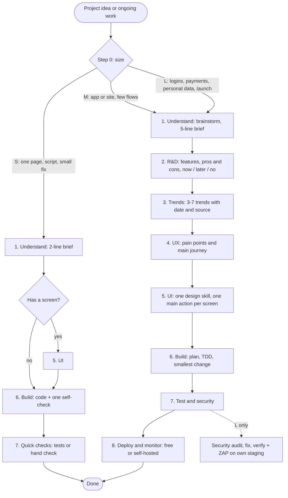

# Project Flow

One workflow for every project, for Claude Code and Codex. It sizes the project first, runs only the phases that size needs, and names exactly which skill or plugin to use in each phase, so a small project stays cheap and a big one gets the full checks.

## The flow



S runs all its phases in one turn. M and L run one phase per turn; say "continue" to move on. Every reply starts with the size, the phase and the skill used.

## Phases and what each one uses

| # | Phase | Size | Skills and tools | You get |
|---|---|---|---|---|
| 0 | Size | all | none | S, M or L, in one line |
| 1 | Understand | all | `superpowers:brainstorming` (M, L) | 2-line (S) or 5-line brief |
| 2 | R&D | M, L | `product-management:product-brainstorming`, `write-spec` | feature table: value, effort, pros, cons, now / later / no |
| 3 | Trends | M, L | web search, `deep-research` (L), `competitive-brief`, `scrapling-official` (public pages only), `rea` (free static analysis) | 3-7 trends with date and source, no raw lists |
| 4 | UX | M, L | `ux-researcher-designer`, `design:ux-copy` | pain points, main journey, the fix for each |
| 5 | UI | screen only | ONE of `hallmark`, `design-taste-frontend`, `impeccable`, `frontend-design`; `design:accessibility-review` (M, L) | screens, one main action each, accessibility notes |
| 6 | Build | all | `writing-plans`, `test-driven-development`, `systematic-debugging`, ponytail mode, `copywriting` + `humanizer`, `claude-seo` | working code |
| 7 | Test and security | all | S: tests or hand check. M: `code-review`, `security-review`, eslint, vitest, semgrep, npm audit, lighthouse. L: `ateam-security-audit` audit, fix, verify, Playwright, OWASP ZAP baseline | findings and fixes |
| 8 | Deploy | M, L | `engineering:deploy-checklist`, Docker, Coolify, self-hosted Sentry or PostHog | deploy, rollback and monitoring plan |

## Rules the flow always follows

- **Free only.** No paid API, paid tier or credit-spending connector: no Together AI images, no DataForSEO, Semrush, Firecrawl or Mobbin, no Hopper or IDA Pro. If unsure whether something costs money, it is skipped.
- **Costs the project itself needs** (payment gateway fees, a domain, live keys) are your decision. The agent names the cost, builds in test mode, and never signs up or pays.
- **Missing tool?** The agent names it, says why and that it is free, and asks. On your yes it reviews the code (licence, install scripts, hooks, network calls, paid parts), installs it and continues. On a no it uses the fallback.
- **Scraping:** public pages only, robots.txt respected, no personal data, never a Cloudflare or anti-bot bypass.
- **Security tests** only on code and systems you own, and only after you confirm the target.
- **One design skill per project**, so design rules never clash.
- Replies come in your language (Hinglish if you write Hinglish).

## Install

Clone once, then copy the skill folder to each agent:

```sh
git clone https://github.com/sahibsingh/Project-Flow.git
cp -r Project-Flow/skills/project-flow ~/.claude/skills/   # Claude Code
cp -r Project-Flow/skills/project-flow ~/.agents/skills/   # Codex
```

The flow names skills from plugins such as superpowers, product-management, design, engineering, ateam-security-audit, hallmark, impeccable, humanizer, claude-seo and rea. A skill that is not installed is skipped and the phase's work is done directly; the agent says which skill was missing.

## Use it

Claude Code:

```
/project-flow <one line: what the project is>
```

Codex: `Use the project-flow skill. Project: <one line>`

Ready-to-paste prompts and how to split work between Claude Code and Codex: [skills/project-flow/references/prompts.md](skills/project-flow/references/prompts.md).

## Check the package

```sh
node tests/validate-skill.mjs
```

It checks the skill's metadata, that all eight phases and the free-only rule are present, and that local links work.

## License

MIT. See [LICENSE](LICENSE). Security: [SECURITY.md](SECURITY.md).
